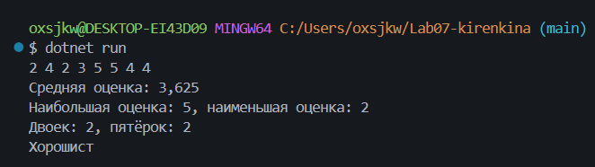
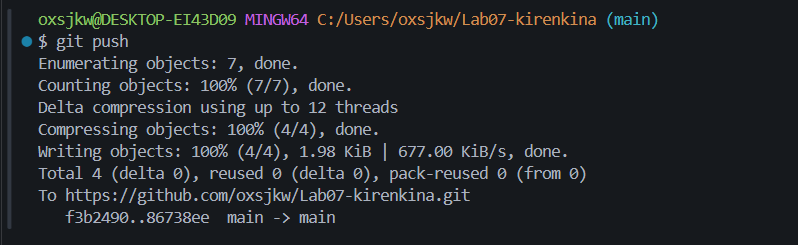

# Практическая работа №7
**ФИО:** Киренкина Вероника
**Группа:** ИСП-241
**Дата:** 20.11.2026
## Что изучено
- Способы создания и заполнения массива
- Цикл foreach
- Способы работы с массивами 

## Результат

